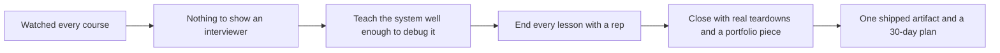
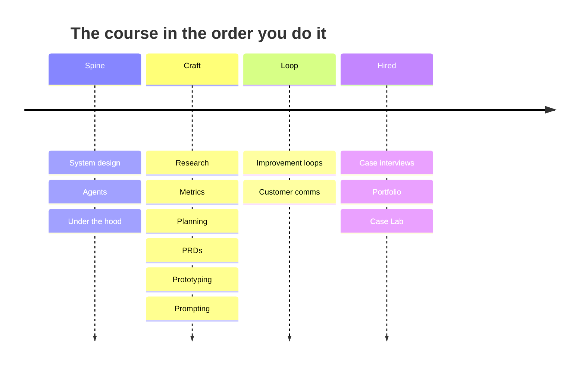

<!-- presentation:start -->
<p align="center"></p>

AI Product Management is a free course for people who want to be hired as an AI product manager and can prove they can do the job. It has 15 chapters and 45 lessons, plus a Start Here lesson, and ends with ten product teardowns. It is live at [hustlersfellowship.com/aipm](https://hustlersfellowship.com/aipm), and this repository holds the source.

## The problem

Most PM courses teach you to talk about AI. Interviews for AI roles ask you to map a system, find where it breaks and show something you shipped. In mentoring, I saw students who had watched every course and had nothing to show, and interviews reward proof. Watching a video does not give you a bottleneck you found or an artifact you made.

The course takes one position in its first chapter: the model is rarely the bottleneck. Retrieval, the choice of lever and the cost per task usually are. That is the kind of sentence an interviewer remembers, so the curriculum is built to teach where AI products break and how to say so plainly. More than 20 professionals reviewed the Fellowship material, and 500 or more people have read it.

## How I approached it



**Key decisions**

| Decision | Why | Trade-off |
|---|---|---|
| Technical chapters stay at PM level: enough to reason about and debug RAG, agents and data structures | A PM who can ask the right question earns an engineer's respect, and nobody expects them to write the code | Engineers will find it shallow, on purpose |
| Same seven blocks in every teaching lesson | A reader always knows where the metrics, the framework and the worked answer are | Less room for a lesson to take its own shape |
| A worked solution in every lesson, with a real prompt and the reasoning | Interview answers are learned by seeing one done step by step | It is one way to answer, and readers may copy it |
| A real company case in every teaching lesson, 35 in total | A real decision at a real company beats an invented example | Cases age and have to be checked |
| Quality, cost per task and trust as the metrics, not daily users | Daily users flatter an AI product while it fails quietly | Harder to measure for a small team |
| Portfolio chapter built on one rule: one shipped artifact beats ten bullet points | It turns the course into something an employer can inspect | It asks for effort a reader may not give |

## What I built

| What | In plain words | Where |
|---|---|---|
| The course | 15 chapters, 45 lessons and a Start Here, about 71,000 words | `ai-pm-2026/chapters/` |
| The reader | Chapter rail, reading pane, progress bar and self-grading quizzes | `ai-pm-2026/shell.html` |
| The curriculum | Titles, order and one argument per chapter | `ai-pm-2026/course_map.json` |
| The publisher | A 94-line script that writes one HTML file | `ai-pm-2026/build.py` |
| The Case Lab | Ten product teardowns in chapter 15 | `ai-pm-2026/chapters/ch15.js` |
| The Hustlers Fellowship landing page | The front door for this and the other course | `index.html` |

### Chapter by chapter

| # | Chapter | Lessons | The question it answers |
|---|---|---|---|
| 01 | AI System Design for PMs | 4 | Where does an AI product actually break |
| 02 | Agentic Architecture for PMs | 3 | When is giving a system agency worth the risk |
| 03 | How It Works Under the Hood | 3 | How does a data choice show up for the user |
| 04 | Product Research for AI | 3 | Which workflow is worth automating |
| 05 | Product Analytics and AI Metrics | 2 | How do I measure quality, cost and trust |
| 06 | Product Planning and Prioritization | 3 | How do I plan when the model keeps improving |
| 07 | AI PRDs and Documentation | 2 | What goes in a spec for a probabilistic feature |
| 08 | Cross-functional Communication | 1 | How do I work with ML engineers |
| 09 | Prototyping and Vibe Coding | 3 | Can I ship a working demo in a day |
| 10 | Prompting as a PM Skill | 2 | How is a prompt a spec |
| 11 | AI Product Improvement Loops | 2 | How does the product get better |
| 12 | Customer Comms and GTM for AI | 1 | How do I sell a probability |
| 13 | AI PM Case Interviews | 3 | How do I answer an AI product case |
| 14 | Portfolio and Positioning for 2026 Roles | 3 | What do I show an employer |
| 15 | The Case Lab: 10 Real Product Teardowns | 10 | How did real products make their bets |

### The ten teardowns

| Product | The bet it is used to teach |
|---|---|
| Cursor | When cheap per task is not cheap |
| Perplexity | Retrieval as the moat |
| Lovable | Speed to demo as a wedge |
| v0 | A narrow wedge with built-in distribution |
| Bolt.new | In-browser execution as the bet |
| Granola | One workflow, done extremely well |
| Gamma | Selling time to output |
| ElevenLabs | Quality bar as the product |
| Cluely | Positioning, virality and the ethics line |
| Replit Agent | Autonomy and the leash |

## How it works

1. `course_map.json` lists every chapter and lesson, with the one argument that chapter must support.
2. Each `chapters/chNN.js` holds that chapter's lessons as plain HTML, keyed by lesson number such as `"4.1"`.
3. `shell.html` holds the page design and the reader.
4. `build.py` marks each lesson live or coming soon, works out progress and navigation, and writes one HTML file.
5. The reader opens that file by double-click or at the live URL. Nothing to sign up for.



## What makes it different

<p align="center"></p>

| | AI Product Management 2026 | A recorded video course | A generic PM course | Interview flashcards |
|---|---|---|---|---|
| Framing | The AI PM job: system, metrics, PRDs | Whatever the instructor films | Classic PM with AI added late | Questions and answers |
| Practice | A rep in every teaching lesson | Optional | A case at the end | Recall only |
| Real cases | 35 industry cases and 10 teardowns | A few anecdotes | A few | None |
| Outcome | A portfolio artifact and a 30-day plan | A certificate | A certificate | Memorised answers |
| To start | Open a page | Create an account | Create an account | Download |

## By the numbers

<p align="center"></p>

The longest chapters are the ones a PM does daily, research and planning, and not the technical ones.

<p align="center"></p>

258 callouts carry the warnings and the lines to say in an interview, so the traps sit next to the advice.

## What this shows

- I begin with a specific failure, graduates with nothing to show, and the course is shaped to fix that one thing.
- I set limits on purpose. The technical chapters stop at PM-level literacy and the guide says why.
- I keep content consistent by structure: the same seven blocks, the same template, the same build.
- I name the real products and cite the real decisions behind them, not invented ones.

## What I would do next

- The teardowns are about 500 words each, much shorter than in the other course. Expand them.
- Chapters 08 and 12 have one lesson each. They need more depth.
- Track how many readers finish the portfolio chapter.
- Re-check the 35 cases against what has changed in the market.

## Tech stack

| Technology | What it does here |
|---|---|
| HTML | Lessons are plain HTML inside JavaScript template strings |
| JavaScript | The reader: rail, lesson loading, quizzes, navigation |
| Python 3 | `build.py`, standard library only |
| Inline SVG | All 49 figures are hand-drawn, no chart library |
| JSON | `course_map.json` is the curriculum |

## Run it locally

```bash
cd ai-pm-2026
python3 build.py
```

Then open `ai-pm-course-master.html` in a browser. The generated file is overwritten on every build, so edit `chapters/` instead.

Built by [Rohit Swerashi](https://github.com/therohitji), Founder & CEO of [GeniOS](https://thegenios.com). [Book a call](https://cal.com/rohitswerashi/genios).

<details>
<summary>Full technical documentation</summary>

# AI Product Management (2026)

A build-first course that makes you a hire-ready AI Product Manager by building, not memorizing. By **Rohit Swerashi**, founder of GeniOS, taught through the **Hustlers Fellowship**.

**Read it live:** https://hustlersfellowship.com/aipm

This repository holds the Hustlers Fellowship landing page and the full source of the AI Product Management course: the curriculum, every lesson, the figures, and the small build script that stitches them into one self-contained HTML file you can open in any browser.

## What this is

Most PM courses teach you to talk about AI. This one teaches you to do the work: map the system, find the bottleneck, ship the proof. It is built as reps you run, not theory you absorb, and it closes with a Case Lab of ten real product teardowns. What you walk into an interview with is a portfolio artifact and genuine case fluency, not a certificate.

## Who it is for

- People breaking into or leveling up as an AI PM, who will build to prove it.
- Operators, analysts, engineers, and students moving into AI product roles.
- Anyone who will use AI at every step and still own the judgment.

It is not for people who want theory to file away without ever shipping anything.

## The curriculum

Sixteen chapters, 46 lessons, from the technical spine to the get-hired playbook.

| # | Chapter | Lessons |
|---|---------|---------|
| 0 | Start Here | 1 |
| 1 | AI System Design for PMs | 4 |
| 2 | Agentic Architecture for PMs | 3 |
| 3 | How It Works Under the Hood (DSA and data, the smart way) | 3 |
| 4 | Product Research for AI | 3 |
| 5 | Product Analytics and AI Metrics | 2 |
| 6 | Product Planning and Prioritization | 3 |
| 7 | AI PRDs and Documentation | 2 |
| 8 | Cross-functional Communication | 1 |
| 9 | Prototyping and Vibe Coding | 3 |
| 10 | Prompting as a PM Skill | 2 |
| 11 | AI Product Improvement Loops | 2 |
| 12 | Customer Comms and GTM for AI | 1 |
| 13 | AI PM Case Interviews | 3 |
| 14 | Portfolio and Positioning for 2026 Roles | 3 |
| 15 | The Case Lab: 10 Real Product Teardowns | 10 |

That is **46 lessons across 16 chapters**.

## How each lesson works

Every teaching lesson follows the same seven-block shape, so you always know where you are:

1. **Your Mandate** the one job of this step
2. **Your Responsibilities** what you own here, and what you do not
3. **Metrics That Matter Here** the numbers that tell you it is working
4. **How to Think Here** the mental model, with one figure
5. **Frameworks to Deploy** the tools you actually use
6. **Worked Solution** the step run on a concrete product
7. **Industry Case** a real, verified company that lived it

Each lesson then ends with **Check Yourself** (a couple of quick questions) and **Apply It Yourself**, the rep you do on your own product or portfolio. The reps are the course; everything else is setup.

## The Case Lab

The final chapter is a Case Lab: ten teardowns of real products, read the way an AI PM reads them in an interview and on the job, so you can run the same teardown live.

## Repository layout

```
.
├── index.html              # the Hustlers Fellowship landing (course catalog)
└── ai-pm-2026/             # this course: AI Product Management (2026)
    ├── ai-pm-course-master.html   # the generated, ready-to-read course (single file)
    ├── build.py                   # stitches the course together
    ├── shell.html                 # the app shell: all CSS and the reader engine
    ├── course_map.json            # the curriculum: chapter and lesson titles, in order
    ├── chapters/                  # lesson content, one file per chapter (chNN.js)
    ├── BUILD_GUIDE.md             # authoring rules and the build pipeline
    └── CURRICULUM.md              # the full curriculum outline
```

## Build it yourself

The course is a single static HTML file generated from the sources. No dependencies beyond Python 3.

```bash
cd ai-pm-2026
python3 build.py
```

That reads `course_map.json` and every `chapters/chNN.js`, injects them into `shell.html`, and writes `ai-pm-course-master.html`. Open that file in any browser to read the course.

Never hand-edit the generated file; it is overwritten on every build. All edits go in `chapters/` or `shell.html`. See [ai-pm-2026/BUILD_GUIDE.md](ai-pm-2026/BUILD_GUIDE.md) for the full authoring rules.

## Credits

Written by **Rohit Swerashi**, founder of GeniOS, for the **Hustlers Fellowship**. Companion course: [Build Live Products](https://hustlersfellowship.com/buildliveproducts) (source: [github.com/therohitji/build-live-products](https://github.com/therohitji/build-live-products)).

Free to read and learn from. Please do not repackage or resell the content.

</details>

<!-- presentation:end -->
