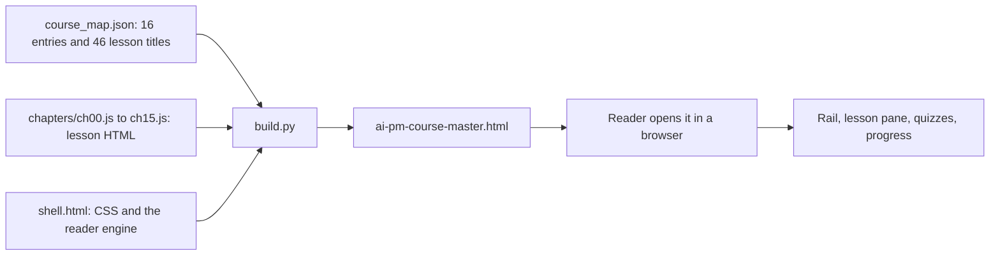
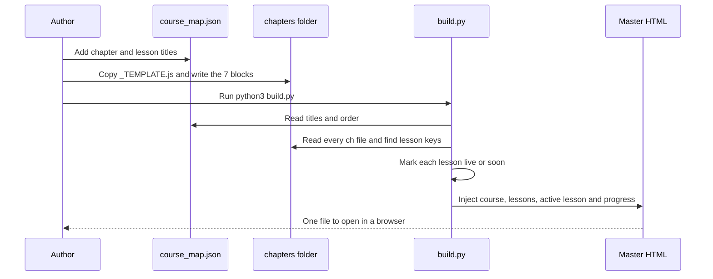

<!-- presentation:start -->
<p align="center"></p>

## Summary

AI Product Management (2026) is a free, build-first field guide for becoming a hire-ready AI product manager. It has 15 chapters and 45 lessons plus a one-lesson Start Here, 71,289 words of lesson text, 49 hand-drawn SVG figures, 70 self-grading quiz blocks and ten real product teardowns in a closing Case Lab. Every teaching lesson follows the same seven blocks and ends with an Apply It Yourself rep. The repository holds the curriculum, every lesson, the Hustlers Fellowship landing page and a 94-line Python build script that produces one self-contained HTML file.

## At a glance

| Fact | Measured value |
|---|---|
| Chapters | 15, plus Start Here (numbered 00 to 15) |
| Lessons | 45, plus 1 Start Here lesson (46 entries in `course_map.json`) |
| Real product teardowns | 10, in Chapter 15 |
| Industry cases, one per lesson 1.1 to 14.3 | 35 |
| Words of lesson text, SVG markup excluded | 71,289 |
| Lines of lesson source in `chapters/` | 6,650 |
| SVG figures | 49 |
| Self-grading quiz blocks | 70 |
| Tables | 105 |
| Callout boxes | 258 |
| Generated course file | 7,028 lines, 694,730 bytes |
| Files in the repository | 30 |
| Languages | HTML, JavaScript, Python |
| Cost to start | Free, no signup |

## What it is

A single-page, self-contained course on doing the AI PM job. It opens as one HTML file with an Excel-style tab rail on the left: chapters as collapsible toggles, lessons under each, and a reading pane on the right. It covers the technical spine a PM needs (system design, agents, data structures), the PM craft (research, analytics, planning, PRDs, communication, prototyping, prompting, improvement loops, go-to-market) and the get-hired playbook (case interviews, portfolio, a 30-day plan).

The technical chapters teach PM-level literacy: enough to reason about and debug a system, never to implement it. The repository keeps that framing as a design decision in `BUILD_GUIDE.md`.

Live version: https://hustlersfellowship.com/aipm

## Why it was built

Most PM courses teach you to talk about AI. This one is built on the premise that an AI PM should be able to map a system, find the bottleneck and ship an artifact, and that a bullet point does not show that. The course states its own thesis in the Portfolio chapter: one shipped artifact beats ten bullet points.

The first chapter takes a position that shapes everything after it: the model is rarely the bottleneck; retrieval, choosing the right lever and unit economics are. The curriculum is built to teach where an AI product breaks, so you can say it out loud in an interview.

## How it works



1. **course_map.json** lists every chapter and lesson title in order, plus a `through_line` for each chapter, the one argument all of its lessons reinforce.
2. **chapters/chNN.js** holds the lessons as raw HTML in JavaScript template literals, keyed by lesson id such as `"4.1"`.
3. **shell.html** is the app shell: all the CSS and the reader engine for the rail, quizzes and navigation.
4. **build.py** stitches them together. A lesson is `live` when its key exists in a chapter file, otherwise `soon`. It also derives the chapter to open, the progress bar and the previous and next links, so none of that is set by hand.
5. **The master file** is generated and never hand-edited.
6. **The reader** gets one file that works by double-click.

## What makes it different

<p align="center"></p>

| | AI Product Management 2026 | A generic PM course | A reading list of AI posts | A set of interview flashcards |
|---|---|---|---|---|
| Framing | The AI PM job: system, metrics, PRDs, evals | Classic PM with AI added at the end | Unordered | Q and A |
| Lesson shape | Seven fixed blocks, same in all 35 teaching lessons | Varies by instructor | None | None |
| Practice | An Apply It Yourself rep in every teaching lesson | Case study at the end | None | Recall only |
| Real cases | 35 industry cases plus 10 full teardowns | A few | Varies | None |
| Technical depth | PM-level literacy: RAG, agents, vector indexes, trees and graphs | Light | Varies | Light |
| Outcome | A portfolio artifact and a 30-day plan | Certificate | Notes | Memorised answers |
| Delivery | One HTML file, no signup | A platform | Browser | An app |

## Features

| Feature | What it is | Where it lives |
|---|---|---|
| Collapsible chapter rail | Chapters as toggles with lessons underneath | `buildNav()` in `shell.html` |
| Progress bar | Derived from the share of live lessons at build time | `__PROGRESS__` in `shell.html`, `build.py` |
| Self-grading quizzes | Two per teaching lesson, right answer revealed with an explanation | `bindQuiz()`, 70 quiz blocks |
| Seven-block lesson | Mandate, Responsibilities, Metrics That Matter Here, How to Think Here, Frameworks to Deploy, Worked Solution, Industry Case | `chapters/_TEMPLATE.js` |
| Apply It Yourself reps | An open problem with hints and a strong vs weak answer table, no answer given | 35 teaching lessons |
| Six-part teardown | The Product, Problem Statement, How It Was Solved, Learnings, What You'd Execute, What You'd Do Differently | `chapters/_TEMPLATE_CASE.js`, Chapter 15 |
| Hand-drawn SVG figures | At least one per lesson, no chart library | 49 `class="fig"` blocks |
| Accent callouts | Interview lines to say out loud and PM takeaways | 107 `callout accent` blocks |
| Monospace flow diagrams | Pipelines and sequences in the `.flow` component | 23 blocks |
| Curriculum brief | Research targets and real cases per chapter | `CURRICULUM.md` |
| Build guide | Hard rules: ids must match, `__NAV__` stays, no hand edits | `BUILD_GUIDE.md` |
| One-command deploy | Rebuild, commit, push and upload | `deploy.sh`, 34 lines |

## By the numbers

<p align="center"></p>

The ten longest chapters by words of lesson text. Product Research for AI is the longest teaching chapter.

<p align="center"></p>

Words in each of the ten Chapter 15 teardowns, longest first. Teardowns are short, about 500 words each.

<p align="center"></p>

What the 46 lesson entries are made of, counted from the source.

<p align="center"></p>

Lessons per chapter for chapters 1 to 10. The course opens with its deepest chapter, System Design, at 4 lessons.

### Every chapter, measured

| # | Chapter | Lessons | Words | Figures | Quiz blocks |
|---|---|---|---|---|---|
| 00 | Start Here | 1 | 1,132 | 1 | 0 |
| 01 | AI System Design for PMs | 4 | 6,322 | 6 | 8 |
| 02 | Agentic Architecture for PMs | 3 | 4,471 | 4 | 6 |
| 03 | How It Works Under the Hood (DSA & Data, the smart way) | 3 | 4,310 | 3 | 6 |
| 04 | Product Research for AI | 3 | 6,719 | 3 | 6 |
| 05 | Product Analytics & AI Metrics | 2 | 4,111 | 2 | 4 |
| 06 | Product Planning & Prioritization | 3 | 6,035 | 3 | 6 |
| 07 | AI PRDs & Documentation | 2 | 3,820 | 2 | 4 |
| 08 | Cross-functional Communication | 1 | 2,137 | 1 | 2 |
| 09 | Prototyping & Vibe Coding | 3 | 5,920 | 3 | 6 |
| 10 | Prompting as a PM Skill | 2 | 3,808 | 2 | 4 |
| 11 | AI Product Improvement Loops | 2 | 4,130 | 2 | 4 |
| 12 | Customer Comms & GTM for AI | 1 | 2,087 | 1 | 2 |
| 13 | AI PM Case Interviews | 3 | 5,188 | 3 | 6 |
| 14 | Portfolio & Positioning for 2026 Roles | 3 | 5,684 | 3 | 6 |
| 15 | The Case Lab: 10 Real Product Teardowns | 10 | 5,415 | 10 | 0 |
| | **Total** | **46** | **71,289** | **49** | **70** |

Chapter 00 is Start Here. Chapter 15 is the Case Lab, whose 10 teardowns carry no quiz blocks.

### The 10 teardowns in Chapter 15

| Lesson | Product | Angle | Study | Words |
|---|---|---|---|---|
| 15.1 | Cursor | When "Cheap Per Task" Lied | unit economics at scale | 607 |
| 15.2 | Perplexity | Retrieval as the Moat | orchestration over one model | 508 |
| 15.3 | Lovable | Speed-to-Demo as a Wedge | speed as the wedge | 510 |
| 15.4 | v0 | A Narrow Wedge With Built-in Distribution | distribution as the moat | 500 |
| 15.5 | Bolt.new | In-Browser Execution as the Bet | architecture as cost moat | 527 |
| 15.6 | Granola | One Workflow, Done Extremely Well | remove friction, don't add features | 516 |
| 15.7 | Gamma | Selling Time-to-Output | time-to-output + cost discipline | 500 |
| 15.8 | ElevenLabs | Quality Bar as the Product | evals in a subjective domain | 495 |
| 15.9 | Cluely | Positioning, Virality & the Ethics Line | the honesty line (cautionary) | 543 |
| 15.10 | Replit Agent | Autonomy and the Leash | blast radius and the leash | 640 |

### The real cases behind the chapters

Every teaching lesson closes its seventh block with a real industry case.

| Chapter | Real cases studied, one per lesson |
|---|---|
| 01 System design | Perplexity, Harvey (twice), Cursor |
| 02 Agentic architecture | Klarna, Cognition vs Anthropic, MCP |
| 03 Under the hood | Perplexity, Harvey, GraphRAG |
| 04 Product research | Jasper vs Sierra, GitHub Copilot, voice agents |
| 05 Analytics and AI metrics | Intercom Fin vs Klarna, the LLM observability stack |
| 06 Planning | The frontier model cadence, RICE for AI bets, OpenAI model retirements |
| 07 AI PRDs | OpenAI Model Spec, Anthropic on evals for agents |
| 08 Cross-functional | Cognition vs Anthropic as a model disagreement |
| 09 Prototyping | Lovable, the citizen-builder workflow, Replit's deleted database |
| 10 Prompting | Leaked system prompts, prompt-evaluation tools |
| 11 Improvement loops | Error analysis, Tesla and Copilot flywheels |
| 12 Customer comms and GTM | DoNotPay, Klarna and Cursor |
| 13 Case interviews | The real hiring loop, Sierra, Perplexity and Harvey |
| 14 Portfolio | The 2026 AI PM job description, builders not talkers, the build-and-apply path |

## Architecture



| Path | What it holds |
|---|---|
| `ai-pm-2026/course_map.json` | Titles, order and one through-line per chapter, 166 lines |
| `ai-pm-2026/chapters/ch00.js` to `ch15.js` | The lesson content, 16 files, 6,650 lines in total |
| `ai-pm-2026/chapters/_TEMPLATE.js` | Blank seven-block lesson skeleton |
| `ai-pm-2026/chapters/_TEMPLATE_CASE.js` | Blank six-part teardown skeleton |
| `ai-pm-2026/shell.html` | All CSS and the reader engine, 289 lines |
| `ai-pm-2026/build.py` | The stitcher, 94 lines, standard library only |
| `ai-pm-2026/ai-pm-course-master.html` | Generated output, 7,028 lines |
| `ai-pm-2026/BUILD_GUIDE.md` and `CURRICULUM.md` | Authoring rules and the chapter research brief |
| `index.html` | The Hustlers Fellowship landing page, 187 lines |
| `deploy.sh` and `favicon.svg` | One-command publish script and the site icon |

## Tech stack

| Technology | What it does here |
|---|---|
| HTML | Lessons are raw HTML inside JavaScript template literals |
| JavaScript | The reader engine: rail, lesson loading, quizzes, navigation |
| Python 3 | `build.py`, standard library only |
| Inline SVG | All 49 figures are hand-drawn, with no chart library |
| CSS | A single light theme in `shell.html` |
| JSON | `course_map.json` is the curriculum |
| Bash | `deploy.sh` for rebuild, push and upload |

## Run it locally

```bash
cd ai-pm-2026
python3 build.py
```

That reads `course_map.json` and every `chapters/chNN.js`, injects them into `shell.html` and writes `ai-pm-course-master.html`. Open it in any browser. Never edit the generated file; it is overwritten on every build.

## Who it is for

- People breaking into or levelling up as an AI PM, who will build to prove it.
- Operators, analysts, engineers and students moving into AI product roles.
- Anyone who will use AI at every step and still own the judgment.
- Not for people who want theory to file away without shipping anything.

## FAQ

**Is the AI Product Management course free?**
Yes. It is free to start and needs no signup. Read it at hustlersfellowship.com/aipm.

**How many chapters and lessons are there?**
15 chapters and 45 lessons, plus a one-lesson Start Here, and ten real product teardowns in the Case Lab.

**Do I need to be an engineer to become an AI product manager?**
No. The course is not an engineering course. Chapters 01 to 03 teach PM-level literacy on RAG, agents, embeddings and data structures, enough to reason about and debug a system without implementing it.

**What is covered in AI PM case interviews?**
Chapter 13 gives a 2026 AI PM case framework and two worked cases: designing an AI agent, and fixing a broken RAG product with a metrics case.

**What is in the portfolio chapter?**
Chapter 14 covers positioning for AI PM roles, building the one artifact that gets you hired and a 30-day plan from reading to offer.

**How do I build the course from source?**
Run `python3 build.py` inside `ai-pm-2026`. It needs only Python 3.

Built by [Rohit Swerashi](https://github.com/therohitji), Founder & CEO of [GeniOS](https://thegenios.com).
<!-- presentation:end -->

## Full documentation

# AI Product Management (2026)

A build-first course that makes you a hire-ready AI Product Manager by building, not memorizing. By **Rohit Swerashi**, founder of GeniOS, taught through the **Hustlers Fellowship**.

**Read it live:** https://hustlersfellowship.com/aipm

This repository holds the Hustlers Fellowship landing page and the full source of the AI Product Management course: the curriculum, every lesson, the figures, and the small build script that stitches them into one self-contained HTML file you can open in any browser.

## What this is

Most PM courses teach you to talk about AI. This one teaches you to do the work: map the system, find the bottleneck, ship the proof. It is built as reps you run, not theory you absorb, and it closes with a Case Lab of ten real product teardowns. What you walk into an interview with is a portfolio artifact and genuine case fluency, not a certificate.

## Who it is for

- People breaking into or leveling up as an AI PM, who will build to prove it.
- Operators, analysts, engineers, and students moving into AI product roles.
- Anyone who will use AI at every step and still own the judgment.

It is not for people who want theory to file away without ever shipping anything.

## The curriculum

Sixteen chapters, 46 lessons, from the technical spine to the get-hired playbook.

| # | Chapter | Lessons |
|---|---------|---------|
| 0 | Start Here | 1 |
| 1 | AI System Design for PMs | 4 |
| 2 | Agentic Architecture for PMs | 3 |
| 3 | How It Works Under the Hood (DSA and data, the smart way) | 3 |
| 4 | Product Research for AI | 3 |
| 5 | Product Analytics and AI Metrics | 2 |
| 6 | Product Planning and Prioritization | 3 |
| 7 | AI PRDs and Documentation | 2 |
| 8 | Cross-functional Communication | 1 |
| 9 | Prototyping and Vibe Coding | 3 |
| 10 | Prompting as a PM Skill | 2 |
| 11 | AI Product Improvement Loops | 2 |
| 12 | Customer Comms and GTM for AI | 1 |
| 13 | AI PM Case Interviews | 3 |
| 14 | Portfolio and Positioning for 2026 Roles | 3 |
| 15 | The Case Lab: 10 Real Product Teardowns | 10 |

That is **46 lessons across 16 chapters**.

## How each lesson works

Every teaching lesson follows the same seven-block shape, so you always know where you are:

1. **Your Mandate** the one job of this step
2. **Your Responsibilities** what you own here, and what you do not
3. **Metrics That Matter Here** the numbers that tell you it is working
4. **How to Think Here** the mental model, with one figure
5. **Frameworks to Deploy** the tools you actually use
6. **Worked Solution** the step run on a concrete product
7. **Industry Case** a real, verified company that lived it

Each lesson then ends with **Check Yourself** (a couple of quick questions) and **Apply It Yourself**, the rep you do on your own product or portfolio. The reps are the course; everything else is setup.

## The Case Lab

The final chapter is a Case Lab: ten teardowns of real products, read the way an AI PM reads them in an interview and on the job, so you can run the same teardown live.

## Repository layout

```
.
├── index.html              # the Hustlers Fellowship landing (course catalog)
└── ai-pm-2026/             # this course: AI Product Management (2026)
    ├── ai-pm-course-master.html   # the generated, ready-to-read course (single file)
    ├── build.py                   # stitches the course together
    ├── shell.html                 # the app shell: all CSS and the reader engine
    ├── course_map.json            # the curriculum: chapter and lesson titles, in order
    ├── chapters/                  # lesson content, one file per chapter (chNN.js)
    ├── BUILD_GUIDE.md             # authoring rules and the build pipeline
    └── CURRICULUM.md              # the full curriculum outline
```

## Build it yourself

The course is a single static HTML file generated from the sources. No dependencies beyond Python 3.

```bash
cd ai-pm-2026
python3 build.py
```

That reads `course_map.json` and every `chapters/chNN.js`, injects them into `shell.html`, and writes `ai-pm-course-master.html`. Open that file in any browser to read the course.

Never hand-edit the generated file; it is overwritten on every build. All edits go in `chapters/` or `shell.html`. See [ai-pm-2026/BUILD_GUIDE.md](ai-pm-2026/BUILD_GUIDE.md) for the full authoring rules.

## Credits

Written by **Rohit Swerashi**, founder of GeniOS, for the **Hustlers Fellowship**. Companion course: [Build Live Products](https://hustlersfellowship.com/buildliveproducts) (source: [github.com/therohitji/build-live-products](https://github.com/therohitji/build-live-products)).

Free to read and learn from. Please do not repackage or resell the content.
